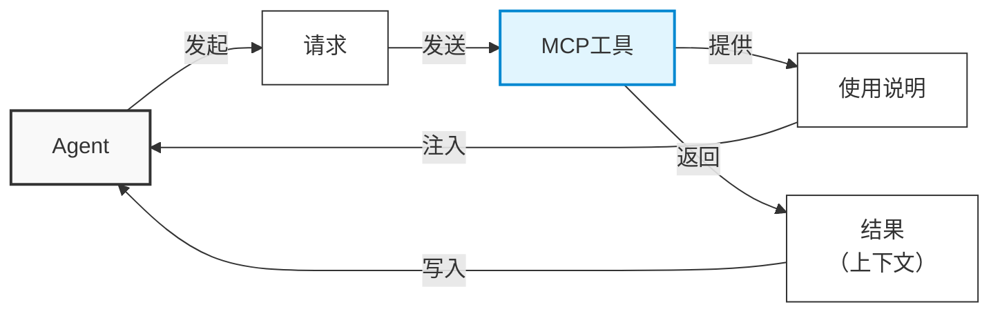

两个月前，我测试过一家国内专利数据库的 MCP 服务。他们的 AI 服务似乎已经推出有一段时间，官网文档看着很齐，功能覆盖也多，于是联系对方申请了试用。可惜实际用下来，产品还是欠打磨，价格也不便宜，最后我们干脆让 Agent 直接操作浏览器来接入 AI。

<!-- more -->

测试中遇到的小问题不少，有些无伤大雅，就不特别吐槽了，只说最要命的一条。

先说明一下 MCP，即 Model Context Protocol，模型上下文协议。这个协议的特点之一，是工具调用的完整返回都会被追加进上下文。

我们当时测试的效果并不好，于是去翻 Agent 的日志排查问题，结果看到了哭笑不得的一幕：Agent 从 MCP 拿到的，是结果表格的全文。也就是说，如果我让它找 RNA 药物的所有相关专利，它查到了 2000 篇，这 2000 行 × 20 列的表格就以纯文本的形式塞给了 Agent。这带来两个问题：

- **上下文浪费**：做查询和统计任务时，我很多时候并不需要全部数据，只看列名和前几行就能了解数据类型；全部数据进入上下文会让这些 Token 照样全额计费，钱白花。
- **上下文污染**：即使到了今天（10 月），这种污染仍会让模型淡化任务目标，导致执行偏离轨道。

结合一些这里没提到的问题，我们最终觉得这个产品实在有些粗糙：功能覆盖得很全，但很多 MCP 工具应该就是把 API 简单再封装了一层，感觉没有真正找用户做过内测——这种明显的问题，但凡自己实际用一次，应该很快就能发现。这也不是 MCP 协议本身的限制造成的无解问题：我后来写 OCR MCP 服务时就受这个问题的启发，特意让 Agent 返回结果的可下载链接，而不是把识别结果灌进上下文。

我想这不会只是一家的问题。AI 相关的产品都在高速发展，这半年我见了一大堆，多数刚起步、不完善。「支持 MCP」「Agent 原生」可能只是 KPI/OKR 上的一行，不管怎样，先上了再说。

对我们自己来说，只能多了解、保持冷静。
