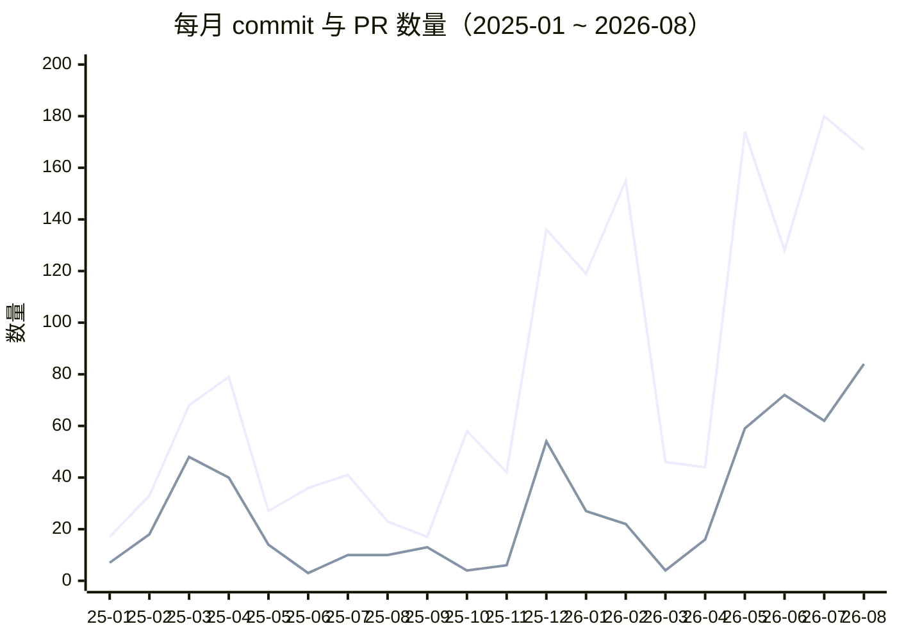
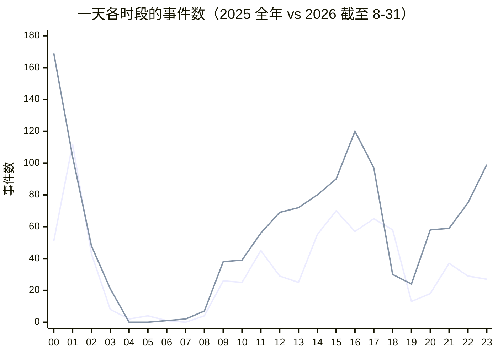
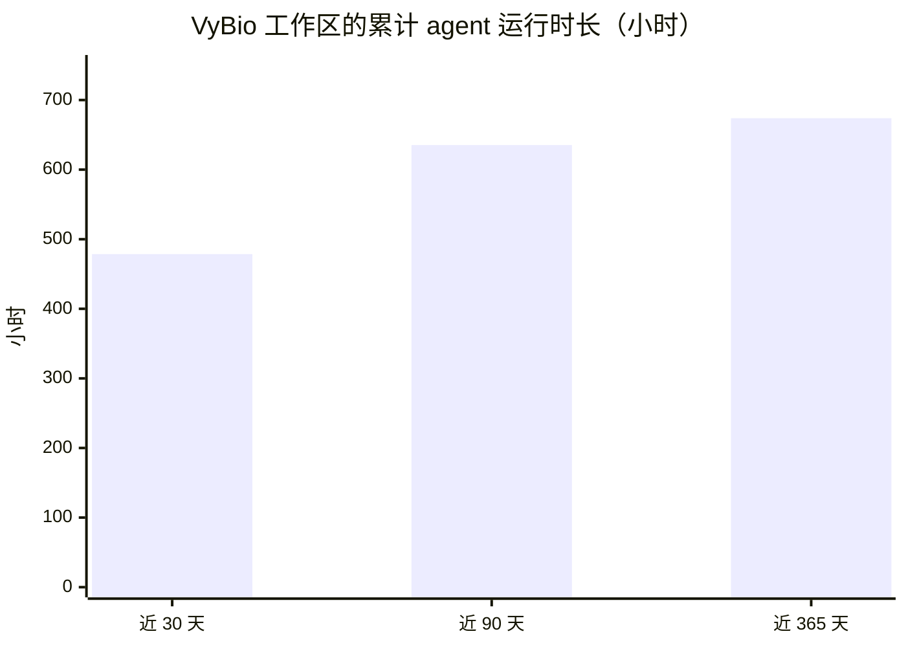
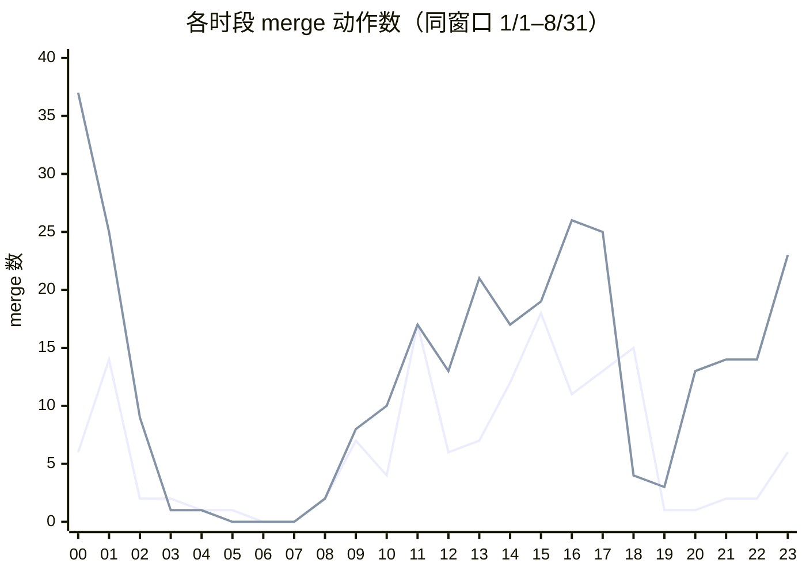
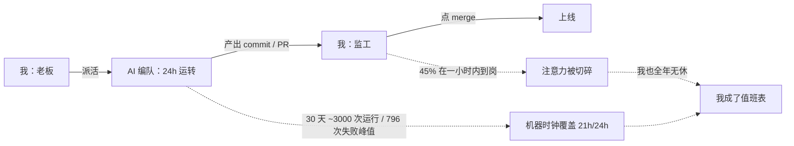

前段时间我跟朋友闲聊时说到了一句话：「我感觉我用 AI 的这个强度，真有机会做老板，我压榨手下人可能比我任何一个老板都狠。」说完我自己也有点好奇——这感觉到底有没有数据支撑？

于是我用 `gh` CLI 把自己 2025、2026 两年所有仓库（40+ 个）的 commit 和 PR 时间戳逐条拉了下来，从**数量**和**发生时间**两个维度做了分布分析。然后从我的 Multica 工作区把那边 agent 编队的运行记录也导了一遍，分析分析我有多黑心。

<!-- more -->

拉完之后先说一句：我确实养了一支 24 小时在岗、从不休周末、工资为零的编队。但数据一起看下来，真正全年无休的那个人，是我。

## 先看账：去年的三倍

为了让两年能直接比，窗口取一样长——都是 1 月 1 日到 8 月 31 日，243 天。

| | 2025 | 2026 |
|---|---|---|
| commit | 324 | 1013 |
| PR | 150 | 345 |
| 有活动的日子 | 111 | 171 |

commit 三倍多，PR 两倍多。单看 8 月更夸张：去年全月 23 个 commit、10 个 PR，今年是 167 和 84。

不过把每个月摊开来看，增长不是慢慢爬上来的，是两级台阶：

*第一条线是 commit，第二条是 PR；2025 是全年，2026 到 8 月底为止。*

2025 年 12 月那次起跳跟 AI 没什么关系，是给公司的网站赶工，12 月 18 号一天就压了 41 个 commit。真正有意思的是 2026 年 5 月的第二次起跳：从那之后 128、180、167，一直没再掉下去。后面所有「越来越密」的感觉，基本都是从这一下开始的。

## 但 commit 的时间戳，量的是机器的时间

写到这儿我本来打算直接画「我几点还在干活」。画之前先想清楚了一件事：我这两年的代码基本都是 agent 写的，本地用 opencode 提交又完全不带署名。也就是说，commit 上的时间戳是机器编队的打卡记录，跟我的作息没什么关系。

这个认知一立，上一节那些曲线就全归到机器那边去了。行吧，那就分开看。

## 机器几点在上班

把一天 24 小时摊开，数每个小时里发生了多少事（2025 全年，对比 2026 到 8 月底）：

*第一条线是 2025，第二条是 2026。*

2025 那条线是标准的上班族形状：下午 14–18 点一个平台，18 点还有 58 次，到 19 点直接断崖到 13 次——当天收工了。凌晨 01 点那根 112 次的尖刺，大概就是半夜想起来什么事又爬起来改两下。

2026 完全换了个形状：白天 09–17 点铺满，晚上 22 点到凌晨 01 点又拖出一条粗尾巴。00 点以 169 次成为全年第 1 大小时，23 点 99 次，20、21、22 点分别是 58、59、75 次。「下班」这个动作，在这条曲线上已经找不到拐点了。

凌晨 03 点到 07 点这几年一直是空的，2026 年 4、5 点一次都没有。所以不是全天候，是醒了就都在。

GitHub 上的 commit 只是编队留下的脚印，它真正在哪儿上班得看调度台。我在 Multica 上有一个专门做生物医药方向的工作区 VyBio，里面常年住着一批智能体，把用量看板拉出来（截至 10 月 17 日）：

| 窗口 | 运行次数 | 运行时长 | 有活动的天 |
|---|---|---|---|
| 近 30 天 | ~3,000 | 478.6 小时 | 26 / 30 |
| 近 90 天 | 4,222 | 635.3 小时 | 78 |
| 近 365 天 | 4,941 | 673.9 小时 | 131 |

看第三列：这一年攒下来的 673.9 个 agent-小时里，71% 发生在最近 30 天，94% 在最近 90 天。所谓「agent 时代」不是慢慢长出来的，是最近三个月一次压上来的。

平均下来，近 30 天每天 16 个 agent-小时，差不多 0.66 个不吃不睡的员工，听着也就那样。但峰值完全不是这个量级：10 月 16 号一天 1352 次运行、106.5 个 agent-小时，等于 4.4 个 agent 并排干满 24 小时，而这一天还挂了 796 次。

挂的原因很朴素：上游模型额度打满、运行时镜像里缺可执行文件。没有一次是「活干不完」，全是机器饿着了。这种事不需要人写代码，只需要人早点看见、顺手点一下重试——而「早点看见」这件事，只能由人来干。

## 我几点在点 merge

代码可以交给机器写，点 merge 交不出去。所以我把全量 PR 的 `merged_at` 拎出来，用 merge 动作来描我自己的时钟：

*第一条线是 2025，第二条是 2026。*

2025 年的我集中在 11–18 点干活，18 点还有 15 次，19 点之后几乎归零，是很正常的白天作息。2026 年 18 点掉到 4 次，19 点以后反而抬起来，23 点 23 次，00 点 37 次。

其余几个数：有审批动作的日子从 69/243 涨到 120/243；夜里（22–06 点）占比 23% → 36%；周末占比 6% → 30%；单日动作跨度中位数 0.5 小时 → 1.1 小时。最长连续出勤从 6 天变成 13 天。

## 那工作时间到底变长了吗

变长了，而且变长的方式比总时长本身更难受。

先说我自己的：merge 动作的单日跨度中位数从 0.5 小时到 1.1 小时，这个数别当「每天工作 1.1 小时」读，它量的是我出现过的时刻有多散。真正有信息量的是最近这段——9 月 1 日到 10 月 17 日这 47 天里，40 天有活动，单日跨度中位数 11.85 小时；10 月前 17 天是 17.1 小时，是整份数据里最长的一个月。

更要紧的是等待被压没了。PR 从开出到 merge 的中位等待，从 12.2 小时缩到 1.5 小时，45% 的 merge 发生在 PR 开出后一小时内，当天开当天合的比例从 48% 涨到 71%。反过来，60 秒内自动合完（当年那批脚本批量同步）的比例从 81% 掉到 34%，9–10 月的 109 次 merge 里只剩 4% 是秒合——以前很多事情脚本自己合完拉倒，现在每一批都得我醒着点一下。

## 所以那句话得改成这样

> ~~我压榨手下人比任何老板都狠~~
> **我给手下（机器）排了 24 小时的班，然后为了不让他们闲着，把自己排成了他们的值班表。**

机器那一侧没有疲劳，只有额度和失败率，累不着；被消耗的是我的注意力，它被切成了一条随时待命的值班曲线。这大概就是那句话里唯一真实的部分：加班在机器时代从一种惩罚变成了默认配置，而这份默认配置，配的还是人。

## 一些说明

- commit 数不等于工作量，里面混着 `pixi.lock`、博客 post、批量同步这类东西，所以我更看重分布指标（单日跨度、静默段、小时分布）而不是总数。
- merge 时间不是纯人工信号：auto-merge 和 CI 自动合也会写 `merged_at`。我剔掉了 60 秒内秒合的，又看了眼深夜那批时间戳的分钟分布确实很散，所以「值班表」部分按上限读；夜间和周末的恶化那部分是稳的。
- 8 月底统计时贡献了不少 commit 的两个组织仓库，现在从账号里消失了，GitHub 搜索也回溯不到，所以 9–10 月的增量和前面的累计数不能直接相减，两段各自成立。
- Multica 的「运行次数 / 时长」和「失败」来自工作区看板的不同视图，口径略有差异，所以分开取近似值，不做交叉相加；失败包含重试，不等于任务失败率。
- 增长也不在博客本身：这段时间 `silen_blog` 只有 19 个 commit，提交最密集的是几个生物信息流水线仓库。也就是说，活的形状早就不是「多写几篇文章」了。
