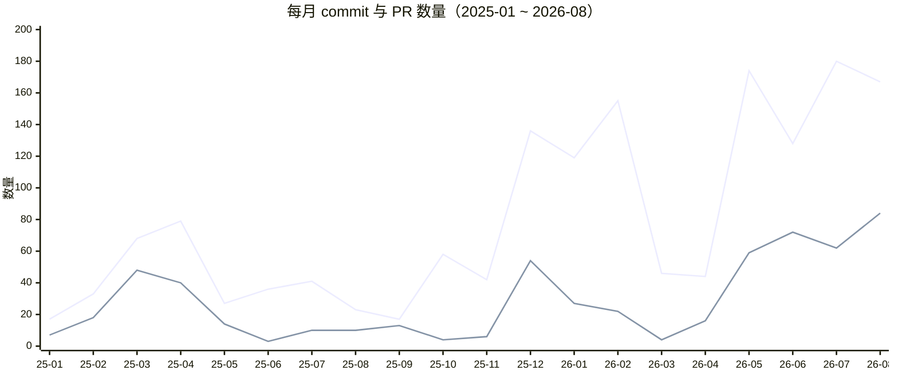
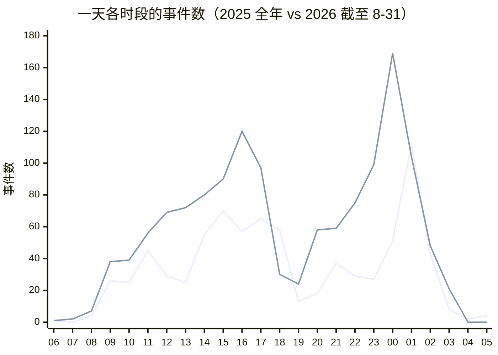

前段时间我跟朋友闲聊时说到了一句话：「我感觉我用 AI 的这个强度，真有机会做老板，我压榨手下人可能比我任何一个老板都狠。」说完我自己也有点好奇——这感觉到底有没有数据支撑？

于是我用 `gh` CLI 把自己 2025、2026 两年所有仓库（40+ 个）的 commit 和 PR 时间戳逐条拉了下来，从**数量**和**发生时间**两个维度做了分布分析，看看我有多黑心。

<!-- more -->

## 工作量确实是涨了

计划统计的时间是8月，为了数据可比，这部分使用的时间段限制在 1 月 1 日到 8 月 31 日，243 天。

| 项目 | 2025 | 2026 |
|---|---|---|
| commit | 324 | 1013 |
| PR | 150 | 345 |
| 有活动的日子 | 111 | 171 |

commit 三倍多，PR 两倍多。单看 8 月更夸张：去年全月 23 个 commit、10 个 PR，今年是 167 和 84。

用所有数据按每个月摊开来看曲线，增长不是慢慢爬上来的，看得出有两次骤升：

*第一条线是 commit，第二条是 PR；2025 是全年，2026 到 8 月底为止。*

2025 年 12 月的第一次骤升并非主动使用 AI ，而是工作变动导致我要维护公司的网站，最多的 12 月 18 号一天就有 41 个 commit。2026 年 5 月迎来第二次骤升：从那之后 128、180、167，一直没再掉下去，因为从那时开始大量的工作都由AI介入了。后面所有「越来越密」的感觉，基本都是从这一下开始的。

## 时间分布并没怎么改

进一步按 24 小时来统计Commit的时间，可以初步对比用 AI 前后的工作时间，25 年（浅色）主要是我自己提交，26 年则基本全是 AI提交了：

2025 那条线是标准的上班族形状：下午 14–18 点一个平台，18 点还有 58 次，到 19 点直接断崖到 13 次——当天收工了。凌晨 01 点那根 112 次的，大概率也不是工作，毕竟我下班了喜欢自己捣鼓点东西。

2026 年形状其实与 2025 类似，然后凌晨的部分，明显更高了。。。

所以从时间分布来说，并无太大变化，虽然数量明显上升，但是毕竟一线的编写，调研工作都不是我在做，是 Agent在执行，所以我自己的工作时间应该是没有明显延长的。

## AI 有被我压榨到么？

实际上，应该没有，显然我布置的任务并么有什么特别大工程，需要长时间持续运行的。现在模型的产出也很快，我的任务要求下去后，应该是没多久就框框做完了，我审核判断的速度跟不上他们的产出，所以他们的时间线才依然跟我的高度重合。

## 不用被挂路灯了

所以，做老板只是幻觉，我依然只是个工作多得做不过来的社畜啊！（摔

不过也不用挂路灯了。。。