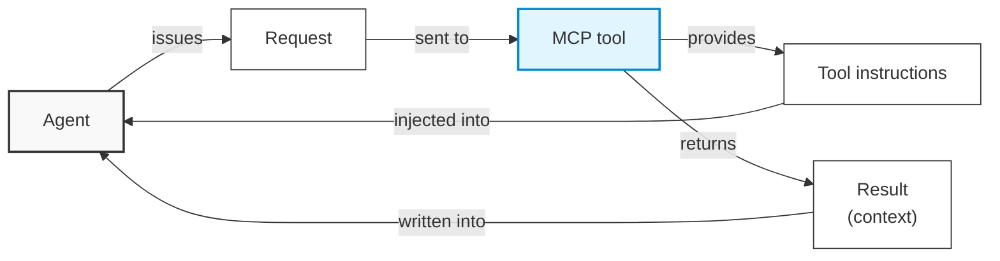

Two months ago I tried the MCP service of a domestic patent database vendor. Their AI offering seemed to have been out for a while, the docs looked complete and the feature coverage was broad, so I asked them for a trial. In practice the product is still rough, and it is not cheap either — in the end we simply had the agent drive a browser to reach the AI.

<!-- more -->

Small problems turned up constantly during testing. The harmless ones are not worth complaining about, so I will only cover the one that really hurt.

First, a definition: MCP, the Model Context Protocol. One of its defining traits is that the complete return of a tool call is appended to the context.

The trial did not go well, so we went through the agent's logs to find out why. What we saw was comical: what the agent received from the MCP was the full text of the result table. So if I asked it for all patents related to RNA drugs and it found 2,000, that 2,000 × 20 table was handed to the agent as plain text. Two problems follow:

- **Wasted context**: for query and statistics work I rarely need all the data — column names and the first few rows already tell me the shape. With everything landing in the context, those tokens are billed in full anyway — money burned.
- **Polluted context**: even today (October), this kind of pollution still dilutes the task objective and sends execution off track.

Together with issues not worth listing here, we concluded that the product is simply rough. The coverage is broad, but many of the MCP tools look like thin wrappers over the plain API, and it does not feel like real users were involved before release — a problem this obvious shows up the first time you actually try it. Nor is this an unsolvable limitation of MCP itself: it is what pushed me, when I later built an OCR MCP service, to have the agent return a downloadable link instead of pouring recognition results into the context.

I doubt this is one vendor's problem. AI products are all racing ahead, and in the past six months I have seen a pile of them — most are early and incomplete. "Supports MCP" and "agent-native" are probably just one line on a KPI/OKR, and whatever the case, ship it first.

For our part, the only option is to learn more and stay calm.
