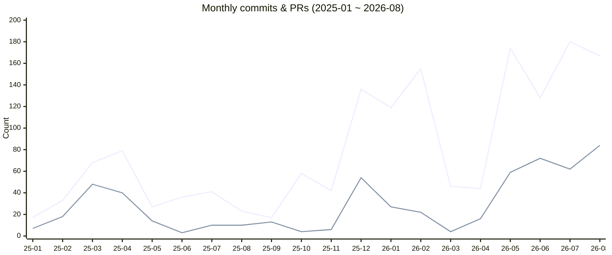
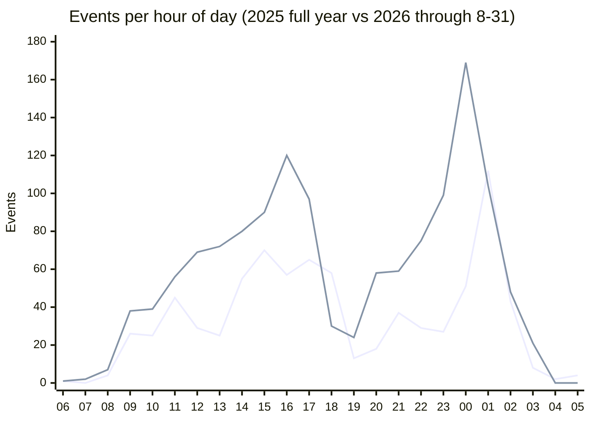

A while back I said to a friend, half joking: "With the amount of AI I'm burning through, if I ever did get to be a boss, I'd squeeze my underlings harder than any boss I've ever had." Then I got a little curious myself — is there actually any data behind that feeling?

So I pulled every commit and PR timestamp from 2025 and 2026 across all my repositories (40+) with the `gh` CLI, and looked at the distribution from two angles: **volume** and **timing**. Let's see how black-hearted I really am.

<!-- more -->

## The workload really did go up

The original plan was to measure through August, so for comparability this part is restricted to January 1 – August 31, 243 days.

| Metric | 2025 | 2026 |
|---|---|---|
| Commits | 324 | 1013 |
| PRs | 150 | 345 |
| Active days | 111 | 171 |

Three times the commits, more than twice the PRs. August alone is even sillier: 23 commits and 10 PRs in the whole month last year, 167 and 84 this year.

Laid out month by month with all the data, the growth didn't creep up — you can see two clear jumps:

*First line is commits, second is PRs; 2025 is the full year, 2026 runs through the end of August.*

The first jump, in December 2025, wasn't me using AI on purpose — a job change put me in charge of the company website, and the busiest day, December 18, had 41 commits on its own. The second jump came in May 2026: after that it went 128, 180, 167 and never came back down, because that's when a large share of the work started going through AI. All the "it keeps getting denser" feeling afterwards starts right there.

## The time distribution barely changed

Breaking commits down by hour of day gives a rough before-and-after comparison of working hours. In 2025 (the lighter line) the commits are mostly mine; by 2026 they're almost all AI's:

The 2025 line is the textbook office-worker shape: a plateau from 14:00 to 18:00, still 58 events at 18:00, then a cliff down to 13 at 19:00 — day over. That 112-event spike at 01:00 is probably not work either; I just like tinkering with my own stuff after hours.

The 2026 shape is actually similar to 2025. The small hours are just visibly busier...

So the time distribution hasn't changed much. The volume clearly went up, but the hands-on writing and research isn't done by me anymore — the agents do it. My own working hours probably haven't stretched much at all.

## So did the AI get squeezed?

Honestly, probably not. None of the tasks I hand over are big projects that need to run for hours on end. Models produce fast these days: I hand over a requirement and it's done before long. My reviewing can't keep up with their output, which is exactly why their timeline still overlaps so tightly with mine.

## Looks like no lamppost for me

So the whole boss thing was an illusion. I'm still just a corporate drone with more work than I can get through! (╯°□°)╯︵ ┻━┻

Though at least nobody needs to hang me from a streetlight...
